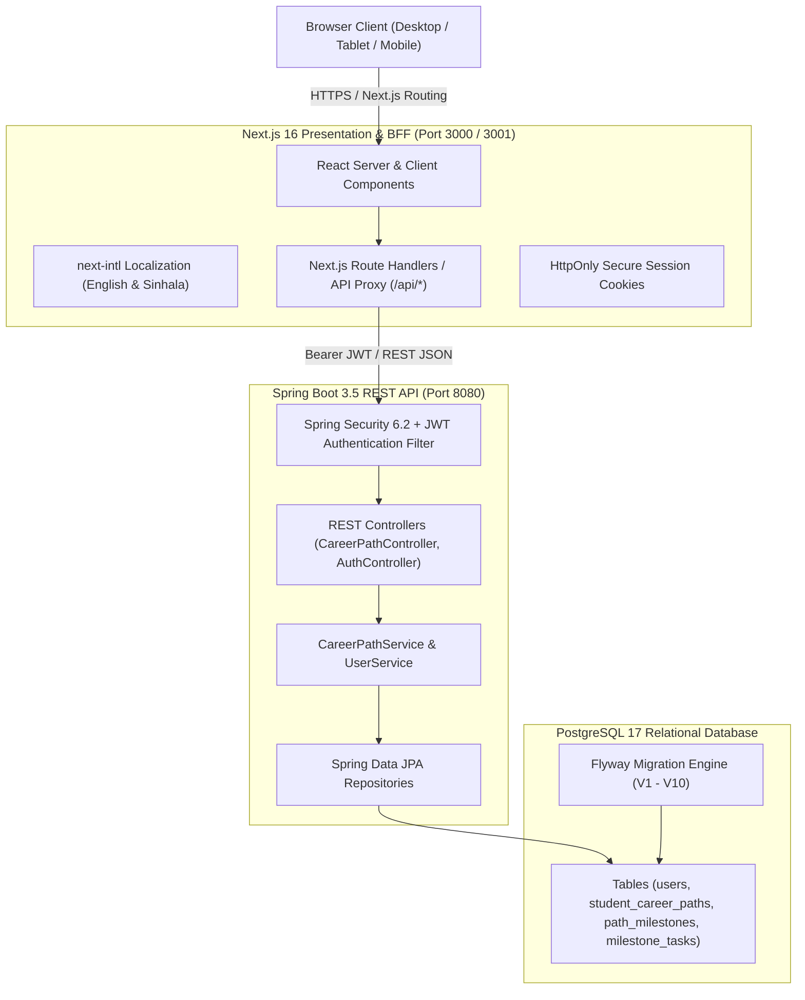
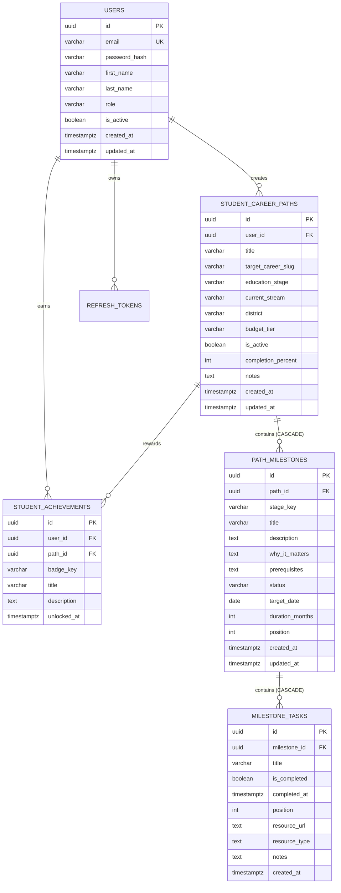

# SkillBridge SL — Career & Education Path Architect

> **EC4307 Web Application Development — Mini Project**  
> An interactive, full-stack education and career pathway platform engineered for Sri Lankan students.  
> Career and university explorer with a personal, editable study-and-career roadmap.

---

## About

Choosing an A/L stream, a degree and a university in Sri Lanka means piecing together information from many places. SkillBridge SL puts it in one site: students explore careers and universities, then turn what they find into a personal roadmap of milestones and tasks that they can edit and track.

## Features

- **Careers** – searchable directory with detail pages (overview, skills, salary, education route, roadmap, related universities, outlook).
- **Universities** – state and non-state institutions with faculties, academics, campus gallery and admissions information.
- **Build Your Path** – step-by-step wizard that generates a roadmap from the chosen career, stage, stream, district and budget.
- **My Path (CRUD)** – create, view, edit and delete roadmaps, milestones and tasks; search, filter by status/stage and sort by order, date, duration or status; progress and achievement badges update automatically; deletes ask for confirmation.
- **Accounts** – register, login, profile update and password change with rotating refresh tokens.
- **Contact form** – messages are stored in the database.
- **English / Sinhala** interface and a responsive layout for phone, tablet and desktop.

## Tech stack

| Layer | Technology |
| :--- | :--- |
| Frontend | Next.js 16 (App Router), React 19, TypeScript, Tailwind CSS 4, next-intl |
| Backend | Java 25, Spring Boot 3.5, Spring Data JPA, Spring Security + JWT, Jakarta Validation |
| Database | PostgreSQL 17, Flyway migrations (`database/migrations`) |
| Testing | Vitest, Playwright, axe-core, Spring Boot Test |

---

## 🏛️ System Architecture



---

## 🗄️ Database Design & Entity-Relationship Diagram (ERD)



---

## 🚀 Setup and Installation Guide

### Prerequisites
* **Java**: JDK 25 installed
* **Maven**: 3.9+
* **Node.js**: v22+ and npm
* **PostgreSQL**: Version 17 running locally

### 1. Database Setup
Log in to PostgreSQL using `psql` and initialize the database:
```sql
CREATE ROLE skillbridge WITH LOGIN PASSWORD 'skillbridge_secret';
CREATE DATABASE skillbridgesl OWNER skillbridge;
```

### 2. Start the Backend API (Spring Boot)
In a terminal:
```bash
cd backend
mvn spring-boot:run -Dspring-boot.run.profiles=local
```
* The API runs at `http://localhost:8080/api`.
* Swagger documentation is accessible at `http://localhost:8080/api/swagger-ui.html`.
* Flyway migrations run automatically on startup from `database/migrations/`.

### 3. Start the Frontend (Next.js)
In a second terminal:
```bash
cd frontend
npm install
npm run dev
```
Open `http://localhost:3000` (or `http://localhost:3001` if port 3000 is occupied).

### Automated One-Click Script
Alternatively, run both frontend and backend concurrently using the root helper script:
```bash
./run-local.sh
```

---

## 🧪 Testing Commands

```bash
# Run frontend unit tests
npm --prefix frontend test

# Run frontend typecheck
npm --prefix frontend run typecheck

# Run backend integration tests
mvn -f backend/pom.xml test
```

---
