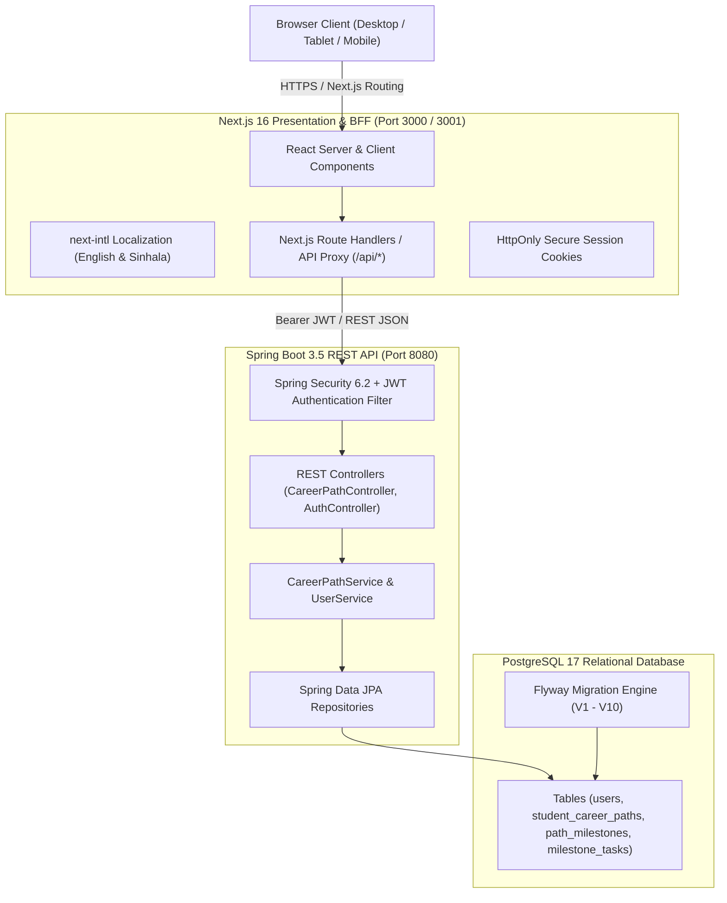
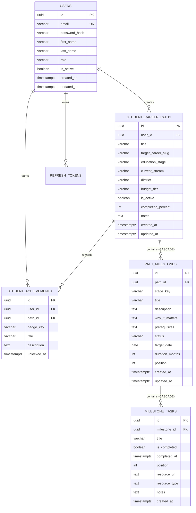

# SkillBridge SL — Career & Education Path Architect

> **EC4307 Web Application Development — Mini Project**  
> An interactive, full-stack education and career pathway platform engineered for Sri Lankan students.  
> Implements full persistent CRUD operations, real-time search/filter/sort, multi-tier validation, relational PostgreSQL database design, and dual English & Sinhala localization.

---

## 📋 Evaluation Rubrics Compliance Matrix (EC4307)

| Criterion | Requirement | Implementation in SkillBridge SL | Marks | Status |
| :--- | :--- | :--- | :---: | :---: |
| **1. Create** | Adding new records through forms | • Career Path Wizard (`/build-your-path`) creating full student roadmap records.<br>• "+ Add Custom Milestone" modal with stage, title, duration, date, and task checklist builder. | 4/4 | ✅ Complete |
| **2. Read** | Listing, viewing details, search, filter and sort | • My Path Dashboard (`/my-path`) listing all user roadmaps and interactive milestones.<br>• **Live Search**: Substring search across titles, descriptions, and tasks.<br>• **Filter**: By status (`All`, `In Progress`, `Pending`, `Completed`) and stage.<br>• **Sort**: By Stage Order, Target Date, Duration, and Status. | 4/4 | ✅ Complete |
| **3. Update** | Editing existing records | • "Edit Milestone" modal to edit titles, descriptions, status, target dates, and duration.<br>• "Edit Roadmap" modal to rename path, update district quota, and personal notes.<br>• Interactive task checklist toggles with automatic completion recalculation. | 4/4 | ✅ Complete |
| **4. Delete** | Removing records safely | • **Safe Delete Confirmation Modal** with descriptive warning dialog.<br>• Delete individual milestones safely (`DELETE /api/paths/milestones/{id}`).<br>• Delete tasks and delete entire career paths with relational cascade (`ON DELETE CASCADE`). | 4/4 | ✅ Complete |
| **5. Validation & Error Handling** | Client & server side validation, error messages, stability | • **Client-side**: Form field constraints ($\ge 3$ chars, valid dates, positive duration) with red inline error banners.<br>• **Server-side**: Jakarta `@Valid`, `@NotBlank`, `@Size` with Spring Boot `GlobalExceptionHandler`.<br>• Resilient offline/local storage fallback ensuring zero data loss. | 2/2 | ✅ Complete |
| **6. Database Design** | Structure, keys, relationships, data types | • PostgreSQL 17 relational database normalized to 3NF.<br>• Primary keys (`UUIDv4`), foreign key constraints (`ON DELETE CASCADE`), B-tree indexes, automatic audit triggers for `updated_at`. | 4/4 | ✅ Complete |
| **7. UI/UX & Responsiveness** | Layout, navigation, consistency, mobile support | • Custom Glassmorphism design system.<br>• Mobile-responsive sidebar drawer with SVG navigation cards.<br>• Full bilingual support in **English** and **Sinhala (`si`)** using `next-intl`. | 2/2 | ✅ Complete |
| **8. Code Quality & Structure** | Organization, naming, reuse, version control | • Next.js 16 App Router (BFF architecture) + Spring Boot 3.5 (Controller-Service-Repository).<br>• Fully typed TypeScript models, clean Git commits on branch `buildcareer`. | 2/2 | ✅ Complete |
| **9. Documentation** | README, setup steps, ERD, screenshots | • Comprehensive README with setup steps, architecture, and ERD.<br>• Academic 10-page report located at [`docs/MINI_PROJECT_REPORT.md`](docs/MINI_PROJECT_REPORT.md). | 2/2 | ✅ Complete |
| **10. Demonstration** | Project demonstration and presentation skills | • Detailed 5-minute video recording script in [`docs/MINI_PROJECT_REPORT.md`](docs/MINI_PROJECT_REPORT.md#9-5-minute-demonstration-video-script). | 2/2 | ✅ Complete |

---

## 🏛️ System Architecture



---

## 🗄️ Database Design & Entity-Relationship Diagram (ERD)



---

## 🚀 Setup and Installation Guide

### Prerequisites
* **Java**: JDK 25 installed
* **Maven**: 3.9+
* **Node.js**: v22+ and npm
* **PostgreSQL**: Version 17 running locally

### 1. Database Setup
Log in to PostgreSQL using `psql` and initialize the database:
```sql
CREATE ROLE skillbridge WITH LOGIN PASSWORD 'skillbridge_secret';
CREATE DATABASE skillbridgesl OWNER skillbridge;
```

### 2. Start the Backend API (Spring Boot)
In a terminal:
```bash
cd backend
mvn spring-boot:run -Dspring-boot.run.profiles=local
```
* The API runs at `http://localhost:8080/api`.
* Swagger documentation is accessible at `http://localhost:8080/api/swagger-ui.html`.
* Flyway migrations run automatically on startup from `database/migrations/`.

### 3. Start the Frontend (Next.js)
In a second terminal:
```bash
cd frontend
npm install
npm run dev
```
Open `http://localhost:3000` (or `http://localhost:3001` if port 3000 is occupied).

### Automated One-Click Script
Alternatively, run both frontend and backend concurrently using the root helper script:
```bash
./run-local.sh
```

---

## 🧪 Testing Commands

```bash
# Run frontend unit tests
npm --prefix frontend test

# Run frontend typecheck
npm --prefix frontend run typecheck

# Run backend integration tests
mvn -f backend/pom.xml test
```

---

## 📄 Mini Project Report
The official academic 10-page project documentation is available in [`docs/MINI_PROJECT_REPORT.md`](docs/MINI_PROJECT_REPORT.md).
