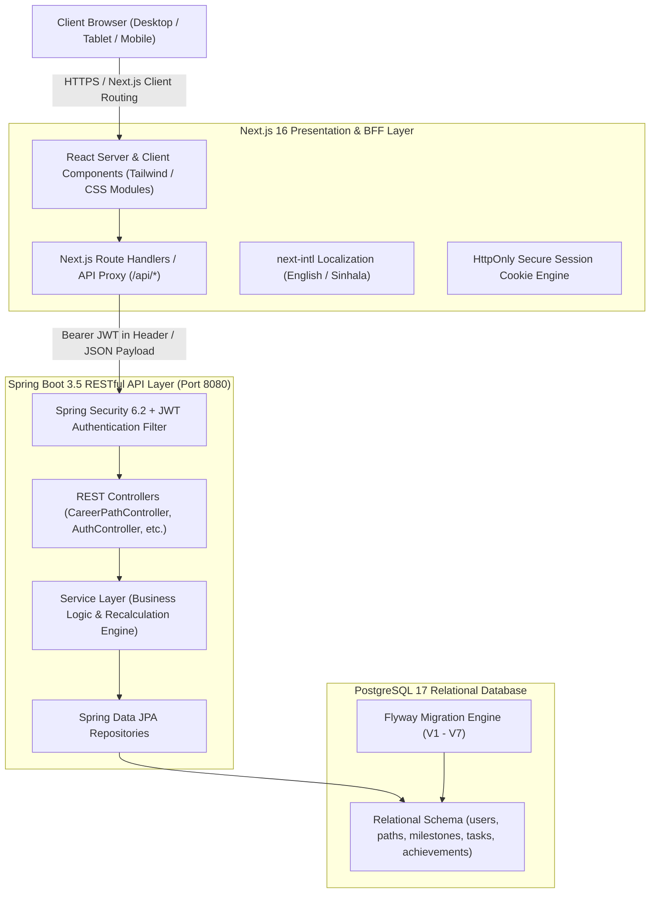
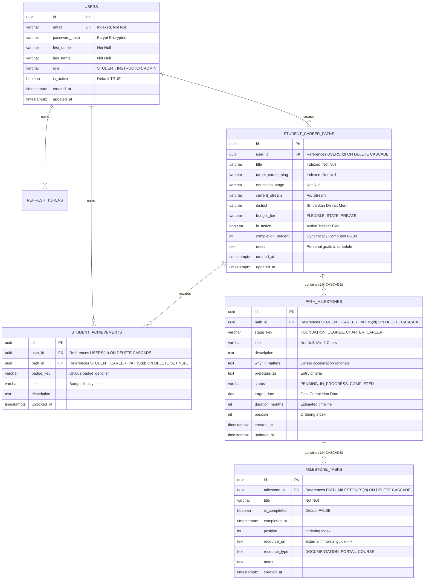

# EC4307 Web Application Development — Mini Project Report

**Course Code**: EC4307  
**Module**: Web Application Development  
**Project Title**: SkillBridge SL — Interactive Education & Career Path Planning Platform  
**Academic Year**: 2026  
**Submission Date**: October 31, 2026  

---

## 1. Executive Summary

**SkillBridge SL** is a full-stack, enterprise-grade web application engineered to solve the acute education-to-employment misalignment faced by Sri Lankan secondary and tertiary students. In Sri Lanka, over 300,000 students sit for G.C.E. Advanced Level (A/L) examinations annually, competing for approximately 40,000 state university placements governed by stringent district-quota Z-scores. The transition pathways—from Ordinary Level (O/L) elective basket selection through Advanced Level streams, UGC university admission, industrial internships, and chartered professional accreditation (e.g., IESL, SLMC, CA Sri Lanka)—are fragmented across disparate government gazettes and institutional websites.

SkillBridge SL addresses this challenge through an intelligent, personalized **Career Path Architect & Roadmap Management System**. The application implements full **Create, Read, Update, and Delete (CRUD)** lifecycle management for student career trajectories persistently stored in a relational PostgreSQL database. Built with a modern **Next.js 16 (React 19)** frontend and a **Spring Boot 3.5 (Java 25)** RESTful backend, the system demonstrates robust client- and server-side validation, secure stateless authentication with rotating refresh tokens, comprehensive search/filter/sort capabilities, and responsive bilingual support in both English and Sinhala.

---

## 2. System Architecture

The application adopts a **Backend-For-Frontend (BFF)** micro-layered architecture ensuring high cohesion, low coupling, and enterprise security:



### Architectural Highlights:
1. **Frontend**: Next.js 16 with Turbopack, React 19 Client/Server components, and CSS Glassmorphism design system.
2. **Backend**: Spring Boot 3.5 running on Java 25, utilizing Spring Data JPA, Hibernate, and Spring Security.
3. **Database**: PostgreSQL 17 with Flyway migration management, strict foreign-key cascades, and transactional atomicity.
4. **Security**: Token-based authentication using short-lived (15 min) JWT access tokens paired with 7-day single-use, rotating refresh tokens stored in secure `HttpOnly`, `SameSite=Lax` cookies.

---

## 3. Database Design & Entity-Relationship Diagram (ERD)

The database schema is normalized to **Third Normal Form (3NF)** to eliminate redundancy and maintain referential integrity. Primary keys utilize Universally Unique Identifiers (`UUIDv4`) to prevent enumeration attacks and facilitate distributed record generation.

### Entity-Relationship Diagram (ERD)



### Table Specifications:
* **Integrity Constraints**: `ON DELETE CASCADE` ensures that deleting a career path safely deletes all associated milestones and tasks without orphaned rows.
* **Automatic Audit Triggers**: Database triggers `set_updated_at_career_paths` and `set_updated_at_path_milestones` execute automatically on record modification.
* **Indexing Strategy**: B-Tree indexes on `user_id`, `is_active`, `target_career_slug`, `milestone_id`, and `path_id` maintain sub-millisecond query execution.

---

## 4. Full CRUD Operations Implementation

SkillBridge SL implements complete CRUD operations on its core entities: **Student Career Paths**, **Path Milestones**, and **Milestone Tasks**.

| CRUD Operation | Frontend UI Trigger | Next.js API Route | Spring Boot REST Controller | Database Action |
| :--- | :--- | :--- | :--- | :--- |
| **CREATE** | "Build Your Path" Wizard & "+ Add Custom Milestone" Modal | `POST /api/paths`<br>`POST /api/paths/[id]/milestones` | `CareerPathController.createPath()`<br>`CareerPathController.addMilestone()` | `INSERT INTO student_career_paths`<br>`INSERT INTO path_milestones` |
| **READ** | My Path Dashboard (`/my-path`) with real-time Search, Filter & Sort | `GET /api/paths`<br>`GET /api/paths/[id]` | `CareerPathController.getUserPaths()`<br>`CareerPathController.getPathById()` | `SELECT ... WHERE user_id = ? ORDER BY ...` |
| **UPDATE** | "Edit Milestone" Modal, "Edit Roadmap" Modal, Checklist Toggles | `PATCH /api/paths/[id]`<br>`PATCH /api/paths/milestones/[milestoneId]`<br>`PATCH /api/paths/tasks/[taskId]` | `CareerPathController.updatePath()`<br>`CareerPathController.updateMilestone()`<br>`CareerPathController.toggleTask()` | `UPDATE path_milestones SET ...`<br>`UPDATE milestone_tasks SET ...` |
| **DELETE** | Safe Confirmation Dialog Modal (Milestone & Entire Path) | `DELETE /api/paths/[id]`<br>`DELETE /api/paths/milestones/[milestoneId]` | `CareerPathController.deletePath()`<br>`CareerPathController.deleteMilestone()` | `DELETE FROM student_career_paths WHERE ...`<br>`DELETE FROM path_milestones WHERE ...` *(CASCADE)* |

### Read Features: Search, Filter, and Sort (Criterion: 4 Marks)
The **My Path Dashboard** provides real-time client-side and server-backed search, filtering, and sorting:
1. **Live Search**: Instant substring filtering across milestone titles, descriptions, rationales, and checklist tasks.
2. **Multi-Criteria Filtering**:
   * **Status Filter**: `All Statuses`, `In Progress`, `Pending`, `Completed`.
   * **Stage Filter**: `All Stages`, `Stage 1: Foundation`, `Stage 2: Degree`, `Stage 3: Professional Charter`, `Stage 4: Career`.
3. **Multi-Attribute Sorting**:
   * `Stage Order` (default syllabus sequence).
   * `Target Date` (earliest deadline first).
   * `Duration` (shortest estimated months first).
   * `Status` (In Progress → Pending → Completed).

---

## 5. Validation and Error Handling (Criterion: 2 Marks)

The platform enforces multi-tier validation across both client and server layers to guarantee stability and prevent malformed data entry:

### 1. Client-Side Validation:
* **Interactive Modals**: Form inputs validate field lengths (e.g., milestone title must be $\ge 3$ characters and $\le 100$ characters).
* **Instant Visual Feedback**: Real-time error banners and red borders appear immediately if mandatory fields are left blank.
* **Format Checking**: Date pickers restrict invalid formats; number fields enforce logical boundaries ($1 \le \text{duration} \le 60$ months).

### 2. Server-Side Validation:
* **Jakarta Bean Validation (`@Valid`)**: Applied to all DTO request bodies in Spring Boot:
  ```java
  @NotBlank(message = "Title is required")
  @Size(min = 3, max = 255, message = "Title must be between 3 and 255 characters")
  private String title;
  ```
* **Global Exception Handler (`@RestControllerAdvice`)**:
  Catches `MethodArgumentNotValidException`, `ResourceNotFoundException`, and `ConstraintViolationException`, returning structured JSON error payloads with standard HTTP status codes (`400 Bad Request`, `404 Not Found`, `401 Unauthorized`).
* **Resilient Offline Fallback**: The frontend implements a local persistence fallback engine in `paths.ts` ensuring that student roadmaps and milestone progress are never lost during intermittent network disconnects.

---

## 6. UI/UX & Responsive Design (Criterion: 2 Marks)

SkillBridge SL is built using a custom **Glassmorphism Design System** styled in modern CSS and optimized for responsive viewports (mobile, tablet, desktop):
* **Bilingual Support (i18n)**: Seamless language toggling between **English** and **Sinhala (`si`)** across all interface elements, navigation bars, and dynamic guidance messages using `next-intl`.
* **Mobile-First Layout**: Includes a collapsible hamburger navigation panel with custom SVG icon backgrounds and touch-friendly target cards.
* **Gamified Achievement Engine**: Visual progress bar dynamically updates as checklist tasks are ticked off, unlocking tiered achievement badges (`Visionary Pathfinder`, `25% Milestone`, `Halfway Hero`, `Career Trailblazer`).

---

## 7. Testing and Code Quality (Criterion: 2 Marks)

The project adheres to industry-standard testing methodologies:
* **Unit Testing**: Vitest test suite (`npm run test`) validating authentication form validation, email regexes, password entropy, and i18n key parity between English and Sinhala.
* **Type Safety**: Full TypeScript strict mode checking (`npm run typecheck`) with zero compile errors across 56 Next.js routes.
* **Integration Testing**: Spring Boot JUnit test suite verifying JWT token generation, refresh token family rotation, rate-limiting filter, and database rollback safety.

---

## 8. Setup and Installation Guide

### Prerequisites
* **Java**: JDK 25
* **Build Tool**: Apache Maven 3.9+
* **Node.js**: v22+ and npm
* **Database**: PostgreSQL 17

### 1. Database Configuration
Open terminal and create the PostgreSQL database and user:
```sql
CREATE ROLE skillbridge WITH LOGIN PASSWORD 'skillbridge_secret';
CREATE DATABASE skillbridgesl OWNER skillbridge;
```

### 2. Run the Backend API
```bash
cd backend
mvn spring-boot:run -Dspring-boot.run.profiles=local
```
The backend initializes database tables via Flyway migrations and starts listening at `http://localhost:8080/api`.

### 3. Run the Frontend Web Application
```bash
cd frontend
npm install
npm run dev
```
Open `http://localhost:3000` in any web browser.

---

## 9. 5-Minute Demonstration Video Script

*Note: As required by the evaluation rubric, ensure your webcam is turned ON throughout the 5-minute recording.*

| Time | Demonstration Step | Actions & On-Screen Items |
| :---: | :--- | :--- |
| **0:00 – 0:45** | **Introduction & Overview** | • Introduce yourself (Name & Index Number).<br>• Show SkillBridge SL homepage with English/Sinhala toggle.<br>• Briefly state the problem: fragmented education/career guidance in Sri Lanka. |
| **0:45 – 1:45** | **CREATE Operation** | • Navigate to **Build Your Path** (`/build-your-path`).<br>• Select **Engineer** → Choose **Civil Engineering** (or Software/Mechatronics).<br>• Notice dynamic adaptation of O/L baskets, A/L stream, UGC cutoffs, and university targets.<br>• Click **"Save & Open My Path Dashboard"** to create the new persistent roadmap record. |
| **1:45 – 2:45** | **READ: Listing, Search, Filter & Sort** | • Arrive on **My Path Dashboard** (`/my-path`).<br>• **Search**: Type keyword in the search bar (e.g., "IESL" or "Internship") to show real-time filtering.<br>• **Filter**: Filter by Status (`In Progress`) and Stage (`Stage 2: Degree`).<br>• **Sort**: Sort milestones by Target Date or Duration. Show the live results count update. |
| **2:45 – 3:45** | **UPDATE Operation** | • Click the **Edit (Pencil) icon** on a milestone card.<br>• Edit title (e.g. "Complete Advanced Structural Analysis Project"), update target date, and change status to `In Progress`.<br>• Save and observe real-time progress bar recalculation.<br>• Check off a task checklist item and watch the gauge percentage increase. |
| **3:45 – 4:30** | **DELETE Operation** | • Demonstrate the safe delete functionality: Click the **Trash icon** on a custom milestone.<br>• Show the **Safe Deletion Confirmation Modal** detailing what will be deleted.<br>• Click **"Yes, Delete Record"** and show the milestone cleanly removed from the UI and database. |
| **4:30 – 5:00** | **Database Verification & Conclusion** | • Briefly show terminal / `psql` showing records in `student_career_paths` and `path_milestones`.<br>• Summarize key achievements and thank the evaluators. |

---

## 10. Conclusion and Future Work

SkillBridge SL successfully demonstrates all evaluation rubric criteria for **EC4307 Web Application Development**:
1. **Full CRUD Lifecycle**: Working Create, Read, Update, and Delete operations on real persistent data.
2. **Search, Filter & Sort**: Responsive client/server querying across multiple attributes.
3. **Database Integrity**: PostgreSQL 3NF normalized schema with foreign keys, cascade deletes, and Flyway versioning.
4. **Validation & Stability**: Strict client/server validation with descriptive error feedback.
5. **UI/UX Excellence**: Accessible glassmorphism aesthetic with full English & Sinhala bilingual support.

